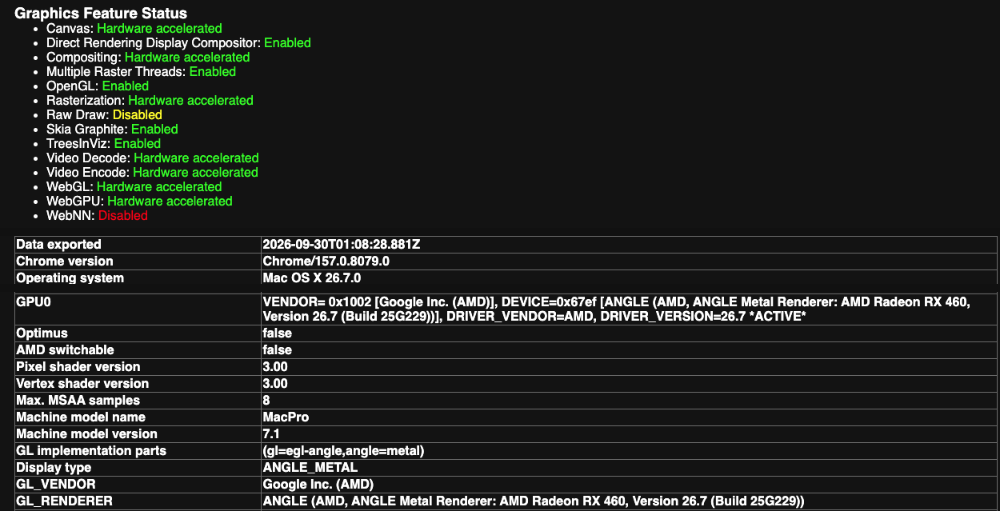

## I've submitted a PR to the original repository, if they accept the PR, this fork will no longer be maintained! So in the future you may have to go to the original project to get newer versions. I will not be updating this until I get a response to the PR.

<p align="left">
  
</p>

# maclator-simplified

**Run arm64 macOS apps on an Intel Mac, with a point-and-click launcher.**

Maclator is a "reverse Rosetta". It loads an arm64 app together with the real arm64 macOS system files (taken from an
Apple Silicon macOS image that *you* download from Apple) and runs the arm64 code on your Intel processor. Metal
graphics can be passed through to your Mac's real GPU.


## macOS support

| Version | Status |
|---|---|
| macOS 26 | Tested, fully works |
| macOS 15 | Tested, fully works | 
| macOS 14 | Untested, probably works |
| macOS 13 | Unsupported, doesn't work |

**Any version below macOS 14 is unsupported, more version support may be added although it's not guranteed.**

## What runs

| Program | Status |
|---|---|
| `fastfetch`, `neatvi` (arm64 command line tools) | works |
| a small AppKit calculator | works |
| VS Code 1.139 arm64 (Electron) | works |
| Chromium 157 arm64 snapshot | works, with **GPU acceleration** |
| balenaEtcher 2.1.7 arm64 (Electron) | starts (disk access untested) |

Not working yet: audio, most hardware access, sandboxed apps, Swift-heavy Apple apps, apps that draw with `CAMetalLayer`.
Apps from the Mac App Store (encrypted) are not supported.



## What you need

- An **Intel Mac** (any Mac that can run macOS 14 or newer; more CPU cores and RAM help a lot).
- **macOS 26** (tested), **macOS 15** (tested) or **macOS 14** (untested)
- About **10 GB** of free disk space and an internet connection for the one-time download.
- Free tools: Xcode Command Line Tools, Rust, and `ipsw`.

## Quick start

 - Download the latest release from releases.

## Building

Open Terminal and run these once:

```bash
xcode-select --install                                   # Command Line Tools (skip if already installed)
curl https://sh.rustup.rs -sSf | sh                      # Rust (skip if already installed)
brew install blacktop/tap/ipsw                           # downloads the macOS system files from Apple

git clone https://github.com/miron302/maclator-simplified
cd maclator-simplified
scripts/install.sh                                       # builds everything and installs Maclator Launcher
```

Then open **Maclator Launcher** from `~/Applications`:

1. **Setup** tab: pick your macOS version and click **Download…** (about 5.5 GB). Wait until the checklist has no red items.
2. **Run** tab: click **Choose App…**, pick an arm64 app, click **Run**.

That's it. The first launch of a big app is slow; later launches are much faster as long as you quit the app normally (Cmd+Q).

New to this? The **[step-by-step tutorial](docs/TUTORIAL.md)** walks through every step.

## How do I know an app will run?

The launcher checks the file for you: a green **arm64** line means Maclator can try it. If it says "no arm64 code", the
app already runs on your Intel Mac without Maclator.

## More help

| | |
|---|---|
| [docs/TUTORIAL.md](docs/TUTORIAL.md) | step-by-step guide, from nothing to a running app |
| [docs/MACOS-VERSIONS.md](docs/MACOS-VERSIONS.md) | using macOS 14, 15 or 26 |
| [docs/USAGE.md](docs/USAGE.md) | the launcher, command line options, Chromium / VS Code / Etcher |
| [docs/TROUBLESHOOTING.md](docs/TROUBLESHOOTING.md) | common problems and fixes |
| [docs/SETUP.md](docs/SETUP.md) | manual setup without the launcher |

## Legal

Maclator contains **no Apple software**. The macOS system files are downloaded by you from Apple's own servers and stay
on your computer. You are responsible for following Apple's license terms for what you download and run, and the
licenses of the apps you run. Maclator does not run or bypass protection on encrypted (FairPlay/DRM) apps.

## Contributors

Original project by [linuxkid473's repository](https://github.com/linuxkid473/maclator).
GUI app by [miron302's repository](https://github.com/miron302/maclator-simplified).

MIT licensed, see [LICENSE](LICENSE) and [NOTICE](NOTICE). 
